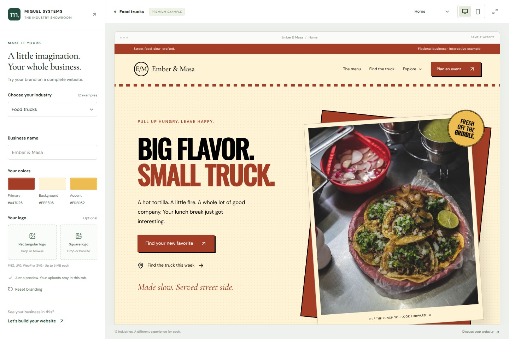

# Service Business Showroom

Choose one of twelve fictional service businesses, change its visual identity, and walk through a customer’s journey. A caterer can estimate an event, a painting customer can explore finishes, and a homeowner can plan an HVAC visit. Each industry has seven pages and its own pricing or scheduling interactions.



## Run locally

Use Node.js 22.13 or newer and npm.

```sh
npm ci
npm run dev
```

Open **http://127.0.0.1:5173**. Choose a business and try a new company name, palette, or logo in the preview. Temporary branding stays in the browser. Prices and reviews are illustrative. The sample inquiry opens a draft addressed to an example mailbox.

## Explore the implementation

- [Industry content and page layouts](industries/) define the twelve businesses.
- [Estimate logic](lib/demo-pricing.ts) applies each industry’s pricing inputs, minimums and readiness rules.
- [Pricing verification](tests/pricing-verification.mjs) checks known examples, line-item totals and invalid inputs. Run it with `npm test`.
- [Image and font credits](docs/credits.md) identify the photography and redistributable typefaces used by this edition. Stock photography loads from its provider when the showroom runs.

Run `npm run typecheck` and `npm run build` to verify the application and produce the static site.
